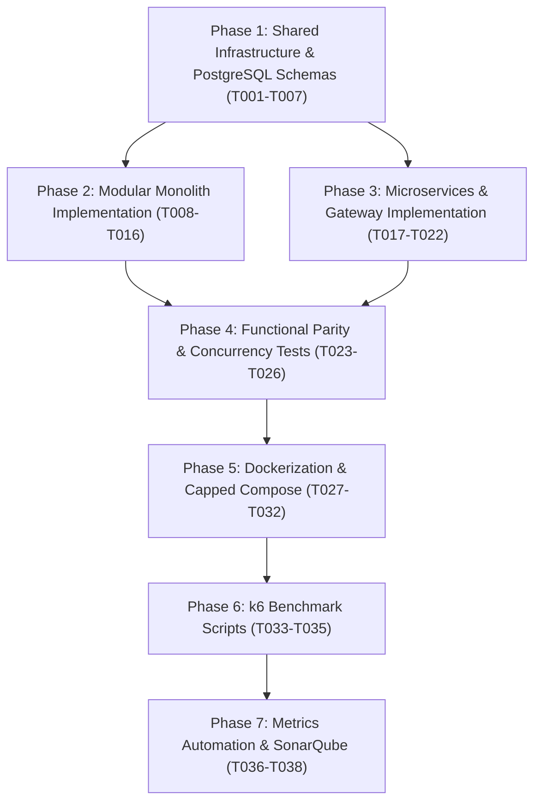

# Tasks: Ticket Architecture Benchmark (Monolith vs. Microservices)

**Input**: Design documents from `specs/001-ticket-reservation/` (`spec.md`, `plan.md`, `research.md`, `data-model.md`, `contracts/openapi.yaml`, `quickstart.md`)

**Prerequisites**: `plan.md` (complete), `spec.md` (clarified), `data-model.md` (defined), `contracts/` (OpenAPI 3.0 specified)

**Organization**: Tasks are structured sequentially across the 7 defined project phases to ensure modular development, verifiable parity, and reproducible benchmarking.

---

## Format: `[ID] [P?] [Phase] Description in path/to/file`

- **[P]**: Can run in parallel (independent files and no mutual blocking dependencies).
- Each task specifies exact file targets and verifiable deliverables.

---

## Phase 1: Shared Infrastructure, DTOs & PostgreSQL Schemas

**Purpose**: Establish the foundational workspace, shared TypeScript types/DTOs, and relational database migrations.

- [x] T001 Setup root monorepo configuration and workspace links in `package.json` and `tsconfig.json`
- [x] T002 [P] Configure shared contracts package in `shared/package.json` and `shared/tsconfig.json`
- [x] T003 [P] Implement domain entity interfaces (`IEvent`, `IReservation`) in `shared/src/models/event.model.ts` and `shared/src/models/reservation.model.ts`
- [x] T004 [P] Implement shared request/response DTOs and validation schemas in `shared/src/dtos/event.dto.ts` and `shared/src/dtos/reservation.dto.ts`
- [x] T005 [P] Implement standardized application error definitions (`AppError`, `InsufficientSeatsError`, `NotFoundError`) in `shared/src/errors/app-error.ts`
- [x] T006 Implement PostgreSQL database initialization script with isolated schemas (`events`, `reservations`), tables, constraints, and indexes in `benchmark/scripts/init-db.sql`
- [x] T007 [P] Implement reproducible seed data script (100 baseline events and 1 high-contention event with 20 seats) in `benchmark/scripts/seed-database.sql`

**Checkpoint**: Shared package compiles and PostgreSQL initialization scripts validate with zero syntax errors.

---

## Phase 2: Modular Monolith Implementation (Treatment A)

**Purpose**: Build the complete Modular Monolith where Events and Reservations communicate in memory via domain interfaces.

- [x] T008 Setup Monolith project structure, dependencies (`fastify`, `pg`), and build settings in `monolith/package.json` and `monolith/tsconfig.json`
- [x] T009 Implement PostgreSQL connection pool and transaction management utilities in `monolith/src/database/db.ts`
- [x] T010 Implement Events repository with parameterized SQL queries for catalog listing and pagination in `monolith/src/modules/events/events.repository.ts`
- [x] T011 Implement Events service in `monolith/src/modules/events/events.service.ts` exposing in-memory domain interfaces (`getEvents`, `getEventById`, `decrementTicketsInTransaction`)
- [x] T012 Implement Events controller in `monolith/src/modules/events/events.controller.ts` exposing `GET /api/events` and `GET /api/events/:id`
- [x] T013 Implement Reservations repository in `monolith/src/modules/reservations/reservations.repository.ts`
- [x] T014 Implement Reservations service in `monolith/src/modules/reservations/reservations.service.ts` executing atomic pessimistic lock (`SELECT FOR UPDATE`) and zero-overbooking check directly in memory
- [x] T015 Implement Reservations controller in `monolith/src/modules/reservations/reservations.controller.ts` exposing `POST /api/reservations` and `GET /api/reservations/:id`
- [x] T016 Implement Monolith server bootstrapping in `monolith/src/server.ts` registering plugins and listening on port 3000

**Checkpoint**: Monolith starts up, connects to PostgreSQL, and successfully serves `GET /api/events` and `POST /api/reservations` on `localhost:3000`.

---

## Phase 3: Microservices Architecture & API Gateway (Treatment B)

**Purpose**: Build the independent microservices communicating via HTTP/REST across the Docker virtual network.

- [x] T017 Setup API Gateway reverse proxy using Fastify in `microservices/services/api-gateway/package.json` and `microservices/services/api-gateway/src/gateway.ts` routing `/api/events` to port 3001 and `/api/reservations` to port 3002
- [x] T018 Setup Events Service structure in `microservices/services/events-service/package.json` and `microservices/services/events-service/src/server.ts` listening on port 3001
- [x] T019 Implement Events Service repository and endpoints in `microservices/services/events-service/src/controllers/events.controller.ts` (including internal atomic endpoint `POST /internal/events/:id/reserve` with `SELECT FOR UPDATE`)
- [x] T020 Setup Reservations Service structure in `microservices/services/reservations-service/package.json` and `microservices/services/reservations-service/src/server.ts` listening on port 3002
- [x] T021 Implement HTTP client with error handling in `microservices/services/reservations-service/src/services/event-client.ts` to call Events Service over Docker network
- [x] T022 Implement Reservations Service repository and controllers in `microservices/services/reservations-service/src/controllers/reservations.controller.ts` delegating ticket verification to Events Service via HTTP

**Checkpoint**: Microservices and API Gateway boot up; calling `http://localhost:3000/api/events` and `http://localhost:3000/api/reservations` correctly delegates requests to ports 3001 and 3002.

---

## Phase 4: Cross-Cutting Functional & Parity Verification Tests

**Purpose**: Automated test suite guaranteeing 100% functional equivalence between Monolith and Microservices.

- [x] T023 Setup automated test harness in `tests/package.json` and `tests/vitest.config.ts`
- [x] T024 [P] Implement API contract compliance tests validating JSON responses against `openapi.yaml` in `tests/contract/api-contract.test.ts`
- [x] T025 Implement architectural parity test suite in `tests/integration/parity.test.ts` executing identical HTTP request sequences against both Treatment A and Treatment B
- [x] T026 Implement concurrency and zero-overbooking verification test in `tests/integration/overbooking-concurrency.test.ts` (sending 50 simultaneous requests for 5 remaining seats)

**Checkpoint**: All parity and concurrency tests pass 100% on both architectures with identical HTTP status codes and responses.

---

## Phase 5: Dockerfiles & Resource-Capped Docker Compose

**Purpose**: Containerize both architectures and establish strict, identical hardware boundaries for scientific validity.

- [x] T027 Create optimized multi-stage build Dockerfile for Monolith in `monolith/Dockerfile`
- [x] T028 [P] Create multi-stage build Dockerfile for API Gateway in `microservices/services/api-gateway/Dockerfile`
- [x] T029 [P] Create multi-stage build Dockerfile for Events Service in `microservices/services/events-service/Dockerfile`
- [x] T030 [P] Create multi-stage build Dockerfile for Reservations Service in `microservices/services/reservations-service/Dockerfile`
- [x] T031 Implement `docker-compose.monolith.yml` deploying Monolith and PostgreSQL with fixed limits (2.0 CPUs, 2048 MB RAM total)
- [x] T032 Implement `docker-compose.microservices.yml` deploying Gateway, Events, Reservations, and PostgreSQL with partitioned resource limits matching the 2.0 CPU / 2048 MB RAM total budget

**Checkpoint**: `docker compose -f docker-compose.monolith.yml up` and `docker compose -f docker-compose.microservices.yml up` start and pass health checks.

---

## Phase 6: k6 Load, Stress & Resilience Benchmark Scripts

**Purpose**: Automated benchmark scenarios for measuring latency, throughput, and fault tolerance.

- [x] T033 Implement k6 nominal load test script in `benchmark/k6/load-test.js` (60s warm-up at 10 VUs, ramp-up from 50 to 200 VUs, 70% reads and 30% reservations)
- [x] T034 Implement k6 high-contention stress test script in `benchmark/k6/stress-test.js` (150 VUs simultaneously competing for the designated 20-seat event to measure p99 latency and verify 0 overbooking)
- [x] T035 Implement fault injection and resilience test script in `benchmark/k6/resilience-test.js` (measuring availability of `GET /api/events` and MTTR when reservations service is interrupted)

**Checkpoint**: Scripts run with `k6 run` and output structured summary metrics without script runtime errors.

---

## Phase 7: Metric Collection Automation & SonarQube Setup

**Purpose**: Scripts to capture container resource utilization (CPU/RAM) into CSV files and configure static code quality auditing.

- [x] T036 Implement automated Docker stats collector in `benchmark/scripts/collect-metrics.ps1` (sampling CPU%, MemMB, Net I/O every 1 second, exporting to CSV)
- [x] T037 Create SonarQube configuration in `benchmark/sonar-project.properties` configured for TypeScript analysis across `/monolith` and `/microservices`
- [x] T038 Implement master benchmark execution orchestrator in `benchmark/scripts/run-all-benchmarks.ps1` automating warm-up, load testing, metrics capture, and CSV consolidation for both architectures

**Checkpoint**: Entire benchmarking pipeline can be triggered with a single script or run individually by the team.

---

## Dependencies & Execution Order

